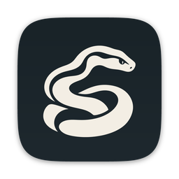
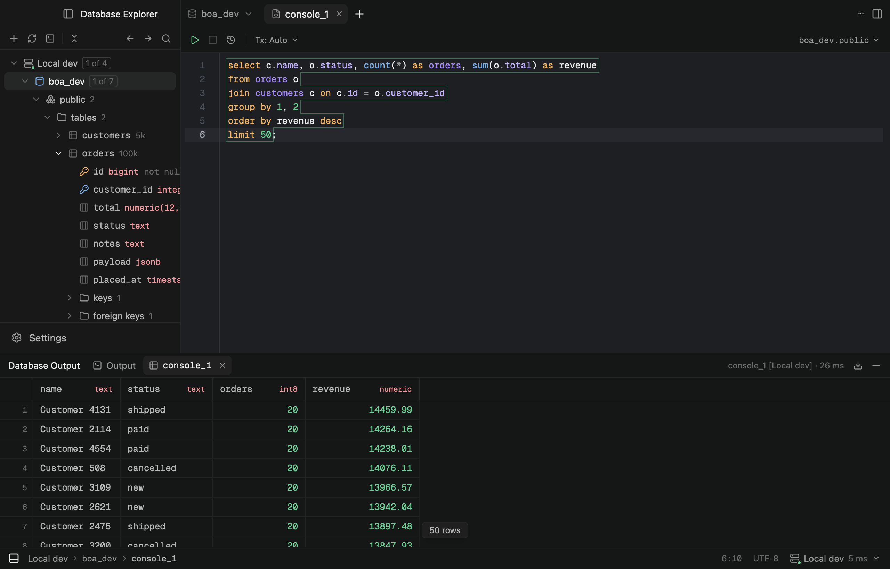

<h1 align="center">
   Boa
</h1>

<p align="center">
  <a href="https://github.com/sharithg1/boa/releases/latest"></a>
  
  
</p>

<p align="center">
  <strong>A fast, native database client for your Mac.</strong><br/>
  Browse schemas, write SQL, edit rows and export results,<br/>
  in a small, quick Rust app that is careful with production.
</p>

<h3 align="center"><a href="https://github.com/sharithg1/boa/releases/latest"><ins>Download Boa</ins></a></h3>

<p align="center">
  
</p>

## Why Boa

The big database IDEs do everything, but they are heavy JVM apps that take a
while to start and want a project before you can run a query. Boa keeps the
parts you use every day (the explorer tree, consoles, an editable data grid,
query history) in a native app built in pure Rust on GPUI. It also puts guard
rails where mistakes are expensive: production connections are marked
everywhere, transactions are visible, and destructive statements ask first.

## Features

### Explore your schema
A Database Explorer tree (connection › database › schema › tables ›
columns), with row counts, showing only the databases and schemas you pick.
Keys, foreign keys, indexes and checks sit under each table, and the DDL
view is the server's own definition. Paste a `postgresql://` URL to add a
data source, and reach private servers through an SSH tunnel that uses your
`~/.ssh/config` and agent.

### SQL consoles
Syntax highlighting, context-aware completion from the live schema (tables,
columns, aliases, CTEs, types), and <kbd>⌘↵</kbd> to run the statement under
the caret. Results land in a paged grid with column types.

### Filter and sort any table
Type a `WHERE` condition or an `ORDER BY` above the grid, or click a column
header to sort. It runs in the query, so it covers every row, not just the
loaded page, and CSV export follows it.

### Edit data like a spreadsheet
Edit cells, add and delete rows in any table with a primary key. Changes are
staged until you submit, the preview shows the exact SQL, and everything runs
in one transaction that rolls back on any error.

### Guard rails for production
Tag a connection Production and give it a colour, shown on the explorer, the
editor and the status bar. `UPDATE` / `DELETE` without `WHERE`, `DROP` and
`TRUNCATE` ask for confirmation, and read-only connections are enforced by
the server.

### Transactions you can see
Switch any session between auto-commit and manual mode. The real transaction
state (idle, open, aborted) is always shown, and Boa asks before
disconnecting or quitting with one open.

### Query history
The queries you run are saved per connection for 30 days (configurable),
failures included; re-running one with other values updates its entry. Search
it as you type (<kbd>⌘⌥E</kbd>), then insert a statement into a console or
open it in a new one.

### Copy as
Select cells or whole rows and copy them as TSV, CSV, Markdown, JSON, SQL
`INSERT` / `UPDATE` statements or an `IN (…)` list.

### CSV export
Export the whole result, not just the loaded page. Postgres streams it with
`COPY`, with progress and cancel in the status bar.

### Picks up where you left off
Tabs, their SQL, the active tab and the panel layout come back on launch.

### Updates itself
New releases download in the background; one click on **Restart to
update** installs them.

Annotated screenshots of each feature are in [showcase/](showcase/README.md).

## Supported databases

**PostgreSQL** today.

## Install

1. Download the `.dmg` for your Mac (Apple silicon or Intel) from the
   [latest release](https://github.com/sharithg1/boa/releases/latest) and
   drag Boa to Applications.
2. If macOS says the app cannot be opened (unsigned builds), run once:

   ```sh
   xattr -dr com.apple.quarantine /Applications/Boa.app
   ```

3. Open Boa, press <kbd>⌘O</kbd> and add a data source.

After that, Boa keeps itself up to date.

## How it works

Boa is a pure-Rust app built on [GPUI](https://gpui.rs/) and
[gpui-component](https://github.com/longbridge/gpui-component), drawn on the
GPU with no web view. `boa-core` owns the database sessions: it connects
with `tokio-postgres`, introspects schemas, runs statements through a
server-side cursor so large results page in, and probes the transaction
state after every statement. `boa-app` is the UI on top of it. Connections
and query history are stored in the app's config directory.

## Development

Building from source, the layout, the checks and the dev hooks: see
[AGENTS.md](AGENTS.md) and the
[run-boa skill](.agents/skills/run-boa/SKILL.md). Releases: run the Cut
release workflow in Actions; its tag starts
[release.yml](.github/workflows/release.yml).

## Licence

MIT. Dependencies are MIT / Apache-2.0 / BSD / ISC / Zlib / Unicode / OFL, or
MPL-2.0 unmodified, enforced by `cargo deny` (`deny.toml`); no GPL.
