# Boa showcase

Annotated screenshots of Boa, the native PostgreSQL client for macOS, from
connecting to a server to editing rows on production. The numbers in each
picture match the list under it.

Every shot is the real app (a debug build) running against the local dev
database (`scripts/dev-fixtures.sh`: `boa_dev` with `customers` and `orders`).
They were rendered offscreen, so the native window chrome (traffic lights, menu
bar) is not in the pictures.

| | |
|---|---|
| **Connect and explore** | [Connection dialog](#adding-or-editing-a-connection) · [Database Explorer](#database-explorer) · [Context menu](#table-context-menu) · [Command palette](#command-palette-k) |
| **Browse data** | [Table tab](#table-tab) · [Filter and sort](#filter-and-sort-on-the-server) |
| **Write SQL** | [SQL console](#sql-console) · [Completion](#schema-aware-completion) · [Query history](#query-history) |
| **Change data** | [Staged edits](#edit-data-like-a-spreadsheet) · [Submit preview](#review-before-submitting) |
| **Stay safe** | [Production marking](#production-is-marked-everywhere) · [Destructive guard](#destructive-statements-ask-first) · [Transactions](#visible-transactions) |

## 1. Connect and explore

### Adding or editing a connection

Add a server with **+** in the explorer toolbar (or paste a `postgresql://` URL). The same dialog edits a saved one.

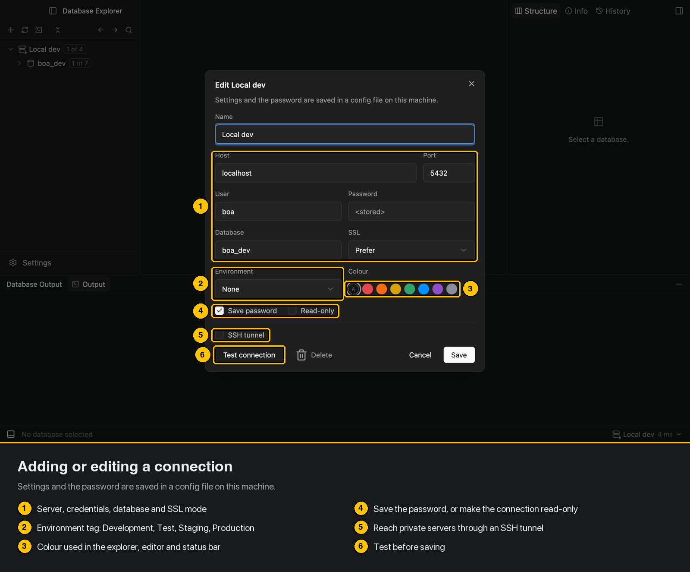

Settings and the password are saved in a config file on this machine.

1. Server, credentials, database and SSL mode
2. Environment tag: Development, Test, Staging, Production
3. Colour used in the explorer, editor and status bar
4. Save the password, or make the connection read-only
5. Reach private servers through an SSH tunnel
6. Test before saving

### Database Explorer

Once connected, the explorer shows only the databases and schemas you chose, down to columns, keys and indexes.

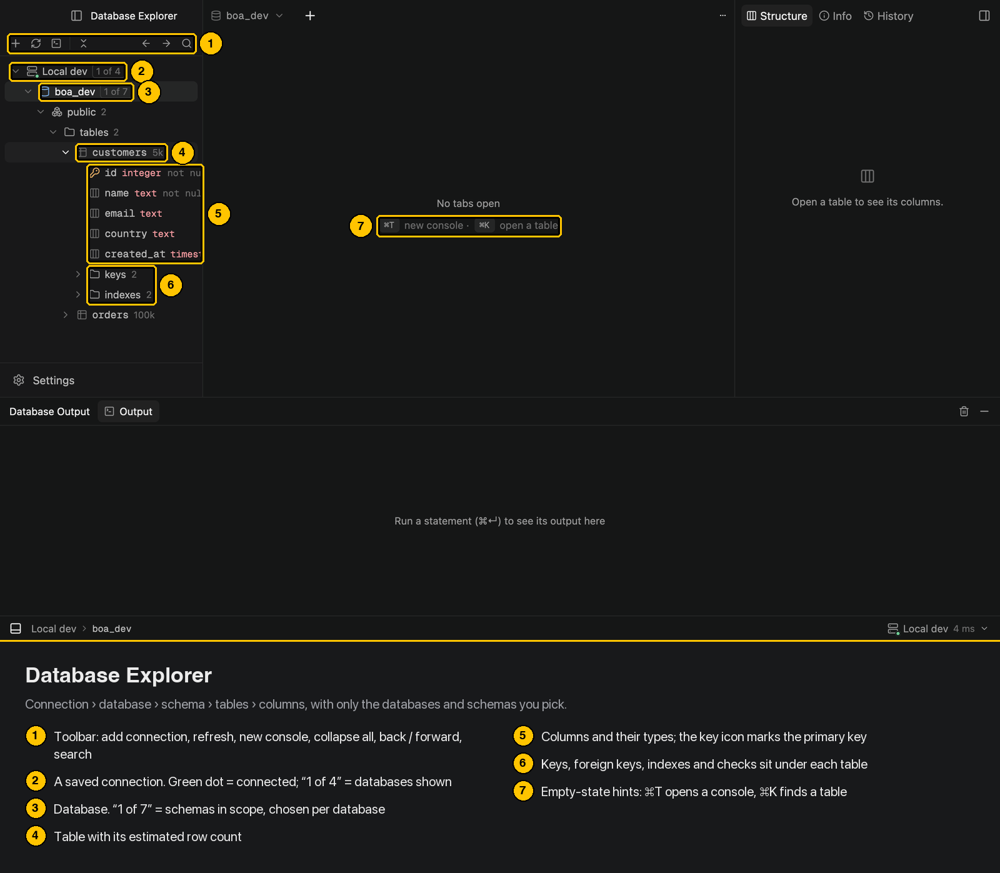

Connection › database › schema › tables › columns, with only the databases and schemas you pick.

1. Toolbar: add connection, refresh, new console, collapse all, back / forward, search
2. A saved connection. Green dot = connected; “1 of 4” = databases shown
3. Database. “1 of 7” = schemas in scope, chosen per database
4. Table with its estimated row count
5. Columns and their types; the key icon marks the primary key
6. Keys, foreign keys, indexes and checks sit under each table
7. Empty-state hints: ⌘T opens a console, ⌘K finds a table

### Table context menu

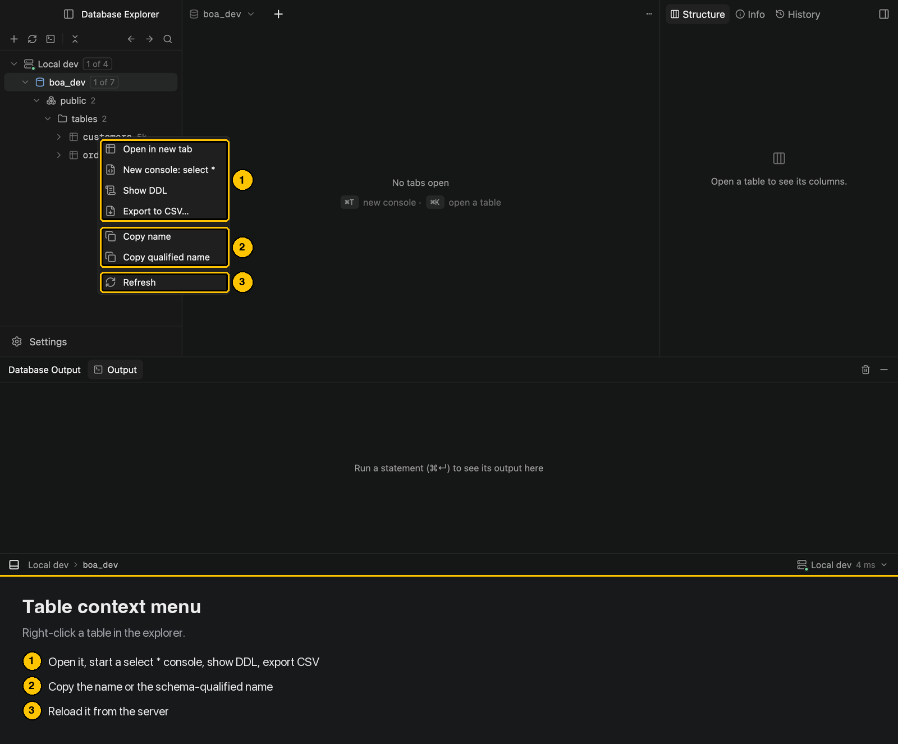

Right-click a table in the explorer.

1. Open it, start a select * console, show DDL, export CSV
2. Copy the name or the schema-qualified name
3. Reload it from the server

### Command palette (⌘K)

Instead of the tree, press ⌘K and type part of a table name.

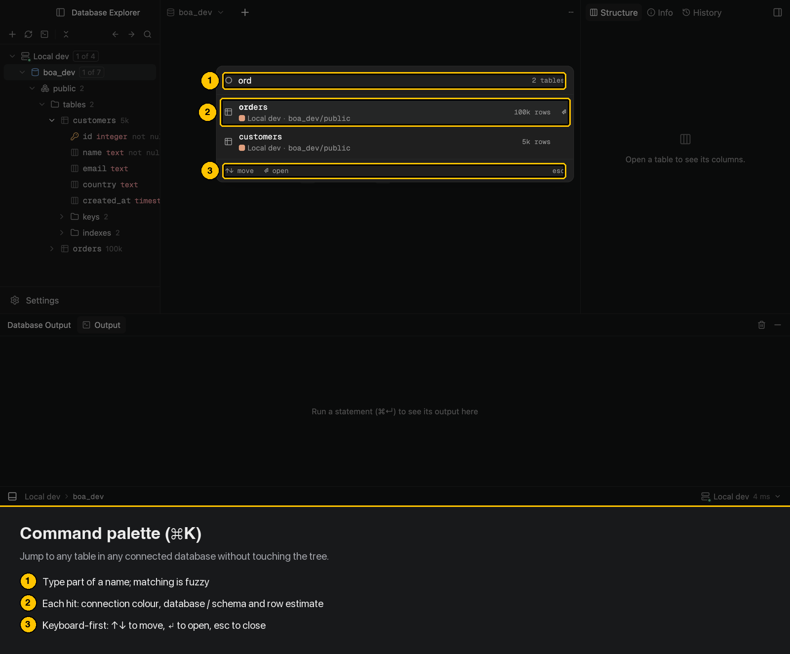

Jump to any table in any connected database without touching the tree.

1. Type part of a name; matching is fuzzy
2. Each hit: connection colour, database / schema and row estimate
3. Keyboard-first: ↑↓ to move, ↵ to open, esc to close

## 2. Browse data

### Table tab

Opening a table (from the tree or the palette) opens a table tab.

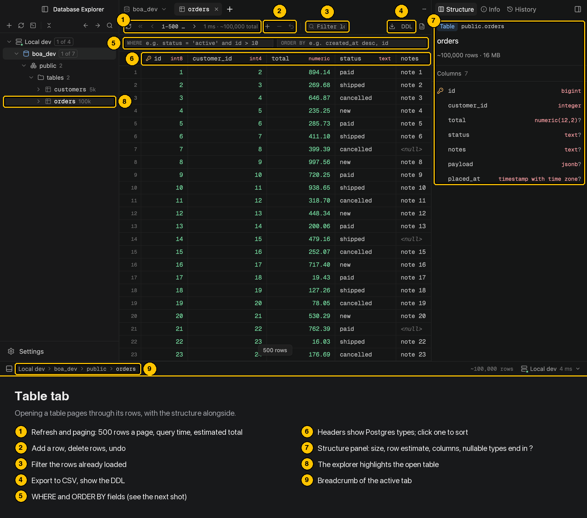

Opening a table pages through its rows, with the structure alongside.

1. Refresh and paging: 500 rows a page, query time, estimated total
2. Add a row, delete rows, undo
3. Filter the rows already loaded
4. Export to CSV, show the DDL
5. WHERE and ORDER BY fields (see the next shot)
6. Headers show Postgres types; click one to sort
7. Structure panel: size, row estimate, columns, nullable types end in ?
8. The explorer highlights the open table
9. Breadcrumb of the active tab

### Filter and sort on the server

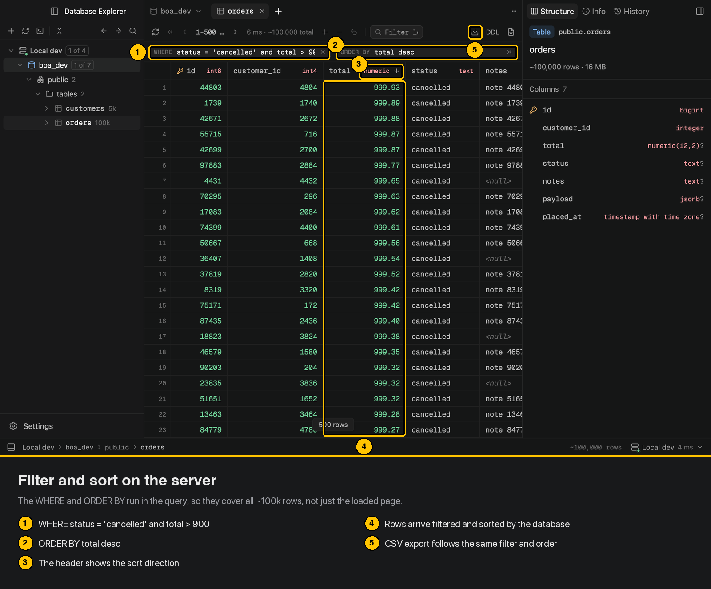

The WHERE and ORDER BY run in the query, so they cover all ~100k rows, not just the loaded page.

1. WHERE status = 'cancelled' and total > 900
2. ORDER BY total desc
3. The header shows the sort direction
4. Rows arrive filtered and sorted by the database
5. CSV export follows the same filter and order

## 3. Write SQL

### SQL console

Press ⌘T for a console on the selected database.

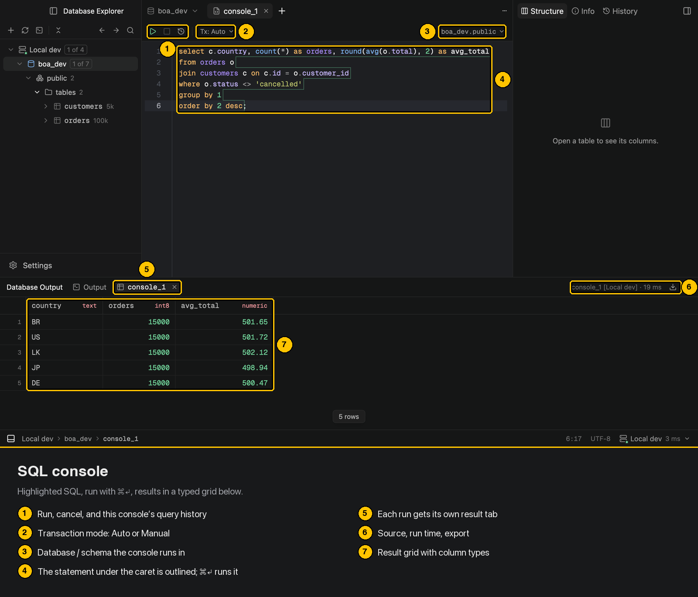

Highlighted SQL, run with ⌘↵, results in a typed grid below.

1. Run, cancel, and this console’s query history
2. Transaction mode: Auto or Manual
3. Database / schema the console runs in
4. The statement under the caret is outlined; ⌘↵ runs it
5. Each run gets its own result tab
6. Source, run time, export
7. Result grid with column types

### Schema-aware completion

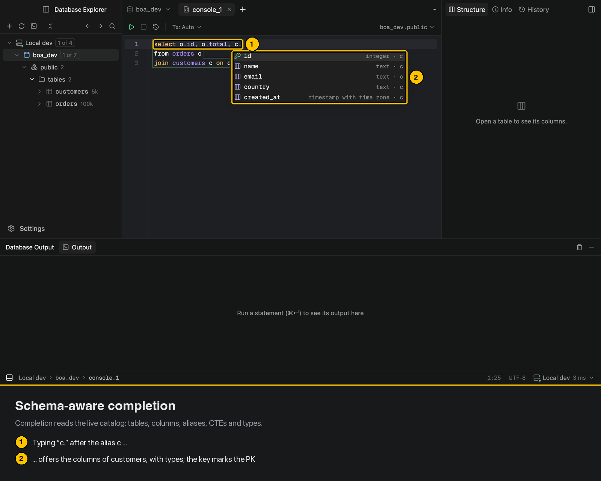

Completion reads the live catalog: tables, columns, aliases, CTEs and types.

1. Typing “c.” after the alias c …
2. … offers the columns of customers, with types; the key marks the PK

### Query history

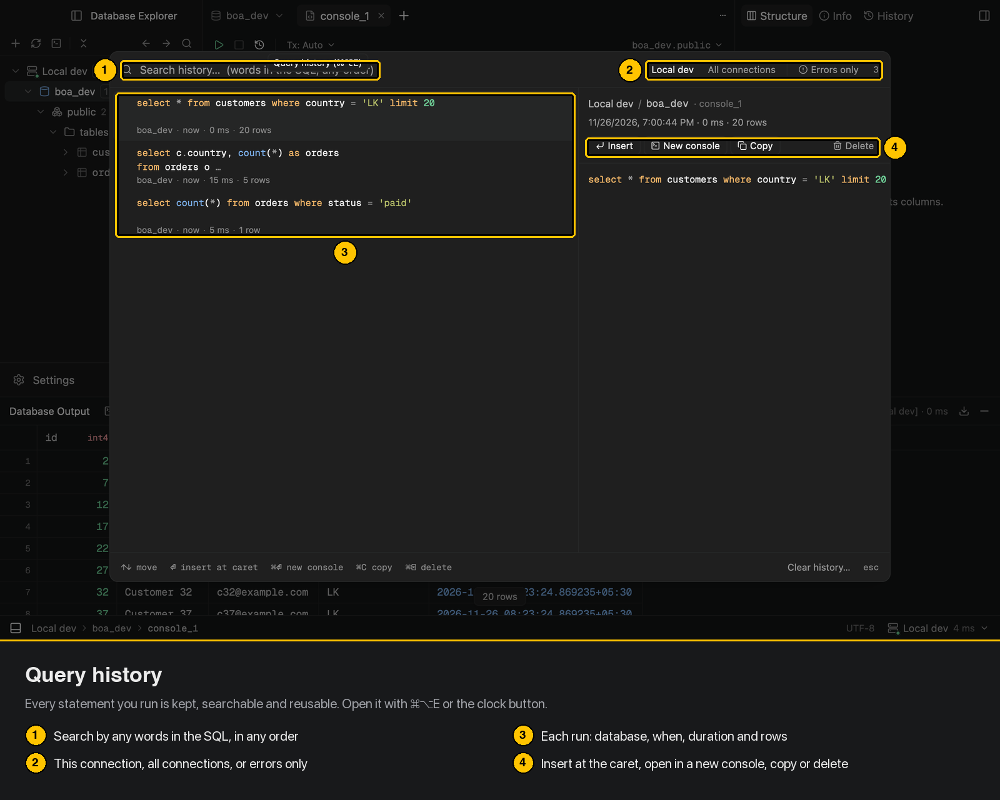

Every statement you run is kept, searchable and reusable. Open it with ⌘⌥E or the clock button.

1. Search by any words in the SQL, in any order
2. This connection, all connections, or errors only
3. Each run: database, when, duration and rows
4. Insert at the caret, open in a new console, copy or delete

## 4. Change data

### Edit data like a spreadsheet

Any table with a primary key is editable in its table tab: type into cells, add rows, delete rows.

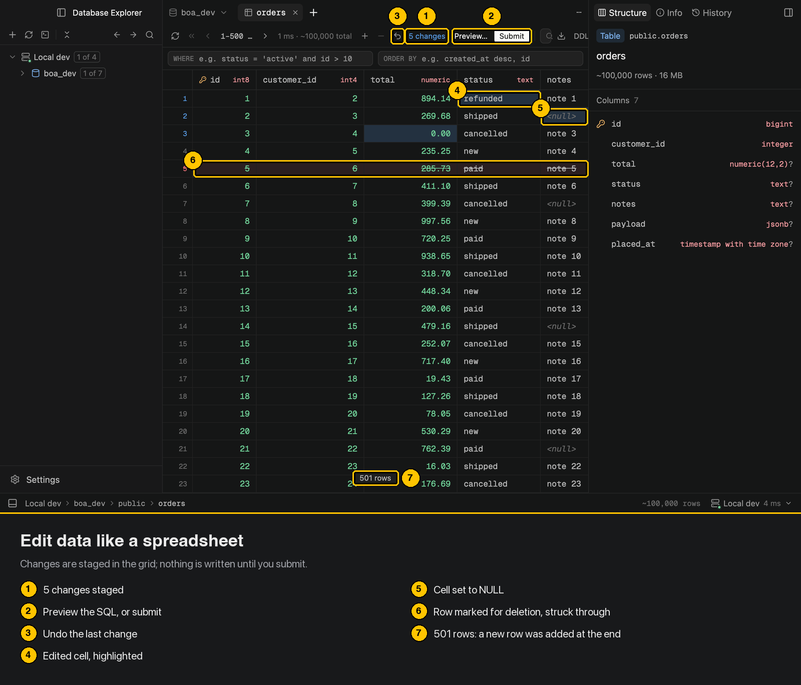

Changes are staged in the grid; nothing is written until you submit.

1. 5 changes staged
2. Preview the SQL, or submit
3. Undo the last change
4. Edited cell, highlighted
5. Cell set to NULL
6. Row marked for deletion, struck through
7. 501 rows: a new row was added at the end

### Review before submitting

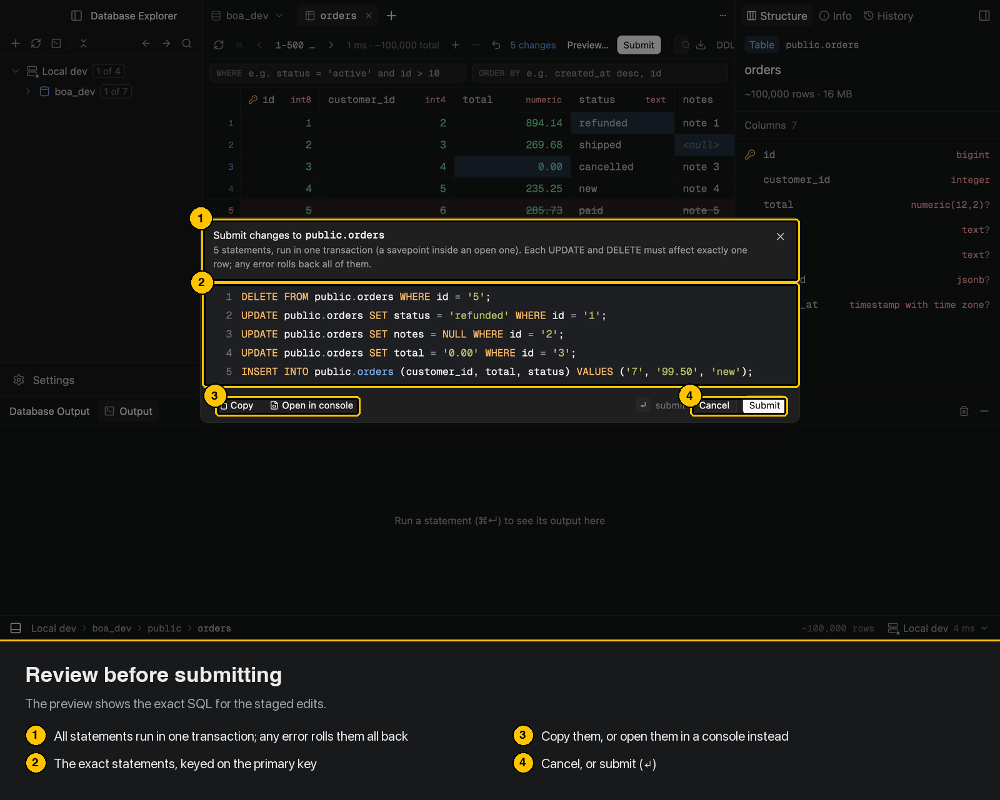

The preview shows the exact SQL for the staged edits.

1. All statements run in one transaction; any error rolls them all back
2. The exact statements, keyed on the primary key
3. Copy them, or open them in a console instead
4. Cancel, or submit (↵)

## 5. Stay safe on production

### Production is marked everywhere

The same Local server, tagged Production in the connection dialog.

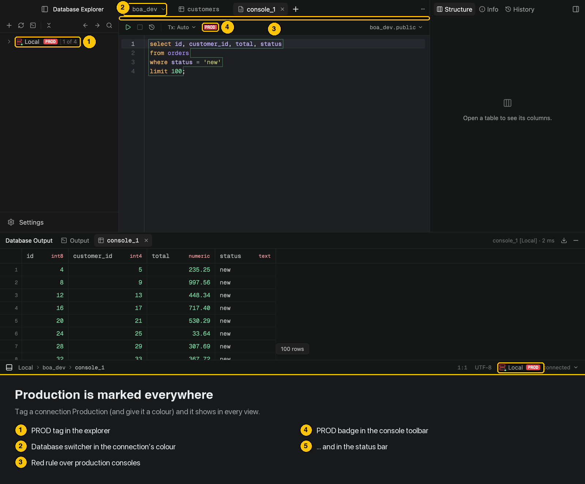

Tag a connection Production (and give it a colour) and it shows in every view.

1. PROD tag in the explorer
2. Database switcher in the connection’s colour
3. Red rule over production consoles
4. PROD badge in the console toolbar
5. … and in the status bar

### Destructive statements ask first

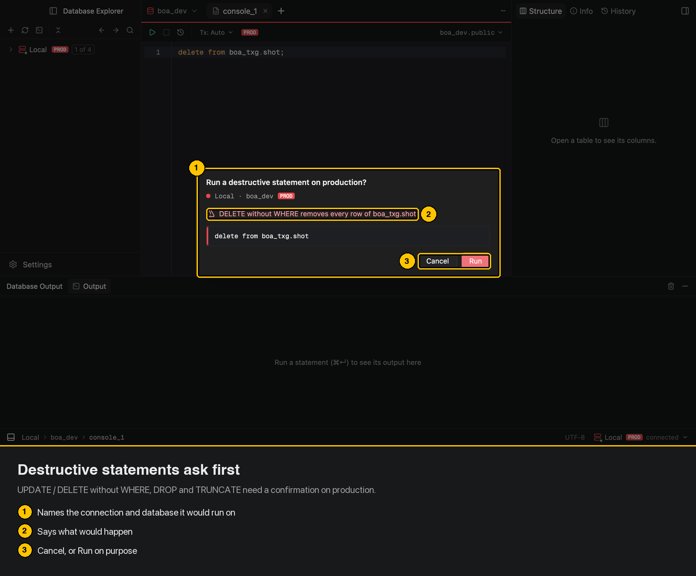

UPDATE / DELETE without WHERE, DROP and TRUNCATE need a confirmation on production.

1. Names the connection and database it would run on
2. Says what would happen
3. Cancel, or Run on purpose

### Visible transactions

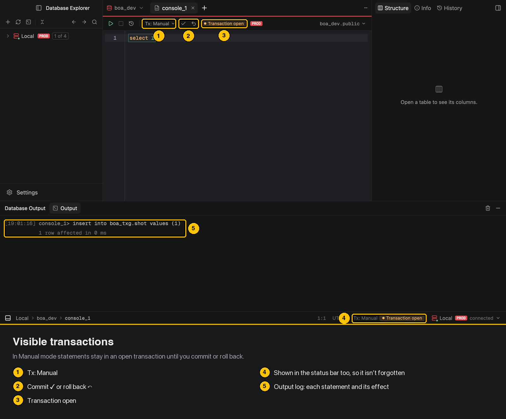

In Manual mode statements stay in an open transaction until you commit or roll back.

1. Tx: Manual
2. Commit ✓ or roll back ↶
3. Transaction open
4. Shown in the status bar too, so it isn’t forgotten
5. Output log: each statement and its effect
